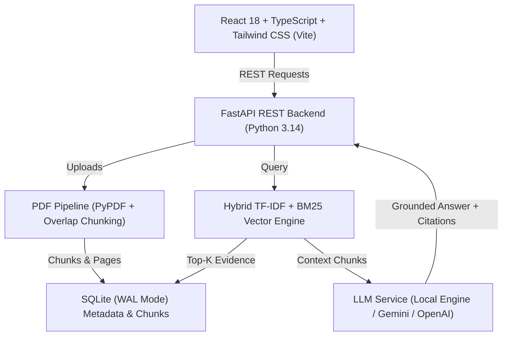

# CampusMind AI — Intelligent College Knowledge Assistant

> **Production MVP for College Technology Expo Showcase**  
> Centralized, evidence-grounded AI assistant for student handbooks, syllabi, course notices, and academic policies with verifiable page citations, hallucination guardrails, and interactive quiz generation.

---

## 🌟 Key Features

1. **📊 Institutional Dashboard**
   - High-level metrics: Total indexed documents, verified pages, vector chunks, chat queries, and quizzes completed.
   - Real-time engine health indicator displaying active provider (*Local Grounded Engine* or *Google Gemini* / *OpenAI*).
   - Quick action shortcuts and empty state guides.

2. **📁 Document Management & Pipeline**
   - Drag-and-drop PDF upload with strict file type and 25 MB size validation.
   - Multi-stage pipeline: PDF validation -> text extraction -> sliding-window overlapping chunking -> vector indexing.
   - Processing statuses: `pending`, `processing`, `completed`, `failed`.
   - Chunk Inspector modal: Explore all extracted passages, token counts, and page numbers.
   - Safe deletion: Purges database records, chunk vectors, and physical files.

3. **💬 Evidence-Grounded RAG Chat Assistant**
   - Multi-turn conversation with session persistence and history sidebar.
   - Document collection scope filter (*All Documents* or specific file).
   - Verifiable page citations: `[Doc Title, Page X]` badges.
   - Interactive Citation Inspector drawer displaying the highlighted source excerpt and relevance score.
   - **Zero-Hallucination Guardrails:** Dual-stage similarity thresholding that returns an honest limitation refusal (*"The uploaded documents do not contain sufficient information..."*) when queries lack evidence.
   - Prompt injection defense: Strict isolation of system instructions from untrusted document text.

4. **📝 AI Quiz Studio**
   - Automated MCQ generator grounded in uploaded document policies.
   - Customizable by topic, difficulty (*Easy*, *Medium*, *Hard*), and question count (3, 5, 10).
   - Interactive Quiz Player with answer selection and progress tracker.
   - Scoring engine with percentage, grade badge, and detailed question-by-question review with policy rationale and page references.

5. **🔍 Semantic Document Search**
   - Hybrid TF-IDF and lexical semantic search across all indexed chunks.
   - Real-time match scoring and one-click citation inspection.

6. **🎯 Technology Expo Demo Mode**
   - Pre-packaged official demo document: **Apex Institute of Technology Student Handbook (2024–2025)** covering 5 realistic academic policy sections.
   - One-click sample load and preloaded demo questions.
   - **Zero-Setup Guarantee:** Works 100% out of the box with the built-in *Local Grounded Synthesizer* without requiring an internet connection or external API keys during expo presentations.

---

## 🏗️ Architecture & Tech Stack



- **Frontend:** React 18, TypeScript, Vite, Tailwind CSS v4, Lucide React.
- **Backend:** Python 3.14, FastAPI, Uvicorn, Pydantic v2.
- **Document Parsing:** PyPDF with page-level text extraction and scanned PDF detection.
- **Vector Retrieval:** TF-IDF Cosine Similarity + BM25-style keyword boosting with stop-word filtering.
- **LLM Layer:** Pluggable engine supporting Google Gemini (`gemini-1.5-flash`), OpenAI (`gpt-4o-mini`), and built-in Local Grounded Synthesizer.
- **Persistence:** SQLite with Foreign Key constraints and Write-Ahead Logging (WAL).
- **Testing:** Pytest and FastAPI TestClient.

---

## 🚀 Quick Start Guide

### Prerequisites
- **Python:** 3.10 to 3.14 installed.
- (Optional) Node.js 18+ (A precompiled frontend bundle is already included in `frontend/dist`).

### 1. Clone & Enter Directory
```bash
cd "c:\Users\Anusuya\Downloads\tech expo"
```

### 2. Install Python Dependencies
```bash
pip install -r requirements.txt
```

### 3. Launch Application (Single Command)
```bash
python run.py
```
*Or double-click `start_app.bat` on Windows.*

The application will start at:
- **Web Application UI:** `http://127.0.0.1:8000`
- **Interactive OpenAPI Docs:** `http://127.0.0.1:8000/docs`

---

## 🧪 Running Automated Tests

Run the backend test suite covering the document pipeline, retrieval, citations, and quiz scoring:
```bash
python -m pytest backend/tests -v
```

Expected output:
```
backend/tests/test_api.py::test_health_endpoint PASSED
backend/tests/test_api.py::test_stats_endpoint PASSED
backend/tests/test_api.py::test_load_sample_and_chat_flow PASSED
backend/tests/test_pipeline.py::test_pdf_validation_valid PASSED
backend/tests/test_pipeline.py::test_pdf_validation_invalid_extension PASSED
backend/tests/test_pipeline.py::test_pdf_validation_corrupt_signature PASSED
backend/tests/test_pipeline.py::test_pdf_text_extraction_and_chunking PASSED
backend/tests/test_quiz.py::test_retrieval_citations_formatting PASSED
backend/tests/test_quiz.py::test_unsupported_question_rejection PASSED
backend/tests/test_quiz.py::test_quiz_local_generation_and_scoring PASSED
============================= 10 passed in 2.86s =============================
```

---

## ⚙️ Configuration & Environment Variables

Copy `.env.example` to `.env` to configure optional external cloud LLM providers:
```ini
# Optional: Cloud LLM API Keys
GEMINI_API_KEY=your_gemini_api_key_here
OPENAI_API_KEY=your_openai_api_key_here

# System parameters
MAX_UPLOAD_SIZE_MB=25
DEFAULT_CHUNK_SIZE=600
DEFAULT_CHUNK_OVERLAP=120
DEFAULT_TOP_K=4
SIMILARITY_THRESHOLD=0.12
DEFAULT_PROVIDER=auto
```
*Note: API keys can also be configured dynamically from the in-app **Settings & Expo** page.*

---

## 🎤 Tech Expo Live Demo Walkthrough

See [`EXPO_DEMO_SCRIPT.md`](file:///c:/Users/Anusuya/Downloads/tech%20expo/EXPO_DEMO_SCRIPT.md) for the 3-minute expo presenter script.

1. **Load Demo Handbook:** Click *"Load Apex Demo Handbook"* on the dashboard.
2. **Test Grounded Policy:** Ask *"What is the minimum attendance requirement for exams?"* and click the Page 2 citation badge.
3. **Test Negative Rejection:** Ask *"What is the recipe for rocket fuel?"* to demonstrate zero-hallucination refusal.
4. **Generate Practice Quiz:** Create a 3-question MCQ quiz on academic policies and complete the score report.
5. **Inspect Vectors:** Click the chunks badge in Document Management to view extracted text passages.

---

## 🔒 Security & Reliability

- **File Validation:** Magic bytes check (`%PDF-`), strict `.pdf` extension check, and 25 MB size limits.
- **Prompt Injection Defense:** System instructions strictly isolate the user query from untrusted document chunks.
- **Fail-Safe Scanned PDF Detection:** Rejects non-text scanned image PDFs gracefully without claiming unreadable content was parsed.
- **Data Privacy:** All documents, vector chunks, chat sessions, and quiz attempts reside locally in SQLite; API keys are never exposed to the frontend.

---

## 🔮 Known Limitations & Future Roadmap

- **Scanned PDF OCR:** Current version extracts embedded PDF text; future release will incorporate Tesseract OCR for scanned photocopies.
- **Complex Table Parsing:** Future update will integrate specialized table extraction for complex multi-column grading matrices.
- **Multi-Modal Support:** Image and chart question answering from academic figures.
